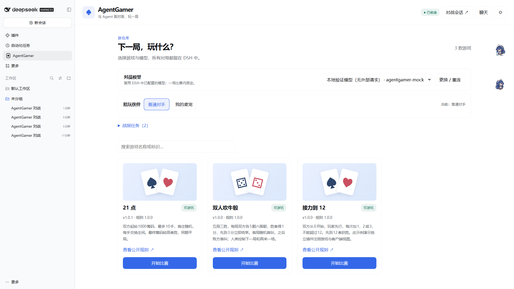
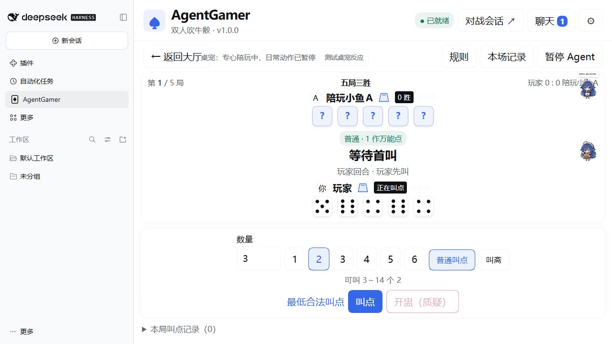

# AgentGamer

[简体中文](https://github.com/AnonNetizen/AgentGamer/blob/main/README.md) | **English**

Play card and dice games against AI or your pet companion inside **DeepSeek Harness (DSH)**.

AgentGamer includes **Blackjack**, **Liar's Dice**, and **Dou Dizhu**, with a lobby, public match history, text and emoji chat, and an API for adding Web games. Use the models and reasoning settings you already configured in DSH, without entering another API key.

[Install from npm](https://www.npmjs.com/package/dsh-agentgamer) · [Release downloads](https://github.com/AnonNetizen/AgentGamer/releases/latest) · [Migration guide](https://github.com/AnonNetizen/AgentGamer/blob/main/docs/migration.md) · [Pet integration](https://github.com/AnonNetizen/AgentGamer/blob/main/docs/companion.md) · [Development guide](https://github.com/AnonNetizen/AgentGamer/blob/main/docs/development.md)

The game UI and the detailed guides linked below are currently in Chinese. This README provides installation and usage instructions in English.



The lobby screenshot shows the two included games and the optional counting extension. Screenshots use an isolated test profile and a local mock model.

## Installation

Validated with **DSH 0.2.2-rc.1, Windows x64, and Node ≥24.9**. The package declares this exact DSH version; other versions need compatibility checks.

If you installed the former `dsh-plugin-agentgamer` package, follow the [migration guide](https://github.com/AnonNetizen/AgentGamer/blob/main/docs/migration.md) to remove it and any corresponding old extension before installing the new package. Enable one main AgentGamer package per Host.

1. Open **Plugins → Add plugin** in the DSH sidebar and install `dsh-agentgamer`.
2. Restart when prompted, open **AgentGamer** in the sidebar, select a model, and connect. You can then start a match.

You can also install through the CLI. For **DSH Desktop**, fully quit DSH, including its tray process, and use the `dsh` command shipped with that Desktop installation:

```powershell
dsh plugin --profile desktop add dsh-agentgamer
```

For the **Web app** launched with `dsh web`, use:

```powershell
dsh plugin --profile web add dsh-agentgamer
```

`desktop` and `web` are profile names. Install into the profile you actually run; for a custom profile, use its name. Reopen the corresponding DSH after installation. Pet integration also requires both plugins to run in the same Host.

For manual package installation, download `dsh-agentgamer-0.3.0.tgz` from [Releases](https://github.com/AnonNetizen/AgentGamer/releases) and replace the package name in the command with `./dsh-agentgamer-0.3.0.tgz`. If the sidebar entry is missing, check that the profile's `dsh.profile.bundles` includes `dsh-agentgamer`.

To uninstall from Desktop, fully quit the app and run:

```powershell
dsh plugin --profile desktop remove dsh-agentgamer
```

Use `web` instead of `desktop` for the Web profile. When upgrading from either `dsh-plugin-agentgamer` or the older RushAgent packages, remove any old counting extension before its main package. See the [migration guide](https://github.com/AnonNetizen/AgentGamer/blob/main/docs/migration.md) for the exact package names and data handling. Closing the Host ends matches held in memory.

## Included games

| Game | Rules version | Format |
| --- | --- | --- |
| [Blackjack](https://github.com/AnonNetizen/AgentGamer/blob/main/rules/blackjack.md) | 1.0.0 | Each player starts with 1,000 chips. Alternate dealer roles for up to 10 hands. A natural Blackjack pays 3:2. |
| [Liar's Dice](https://github.com/AnonNetizen/AgentGamer/blob/main/rules/liars-dice.md) | 1.0.0 | Five dice per player each round, first to three wins. Ones are wild in ordinary bids; straight bids count each face as itself. |
| [Dou Dizhu](https://github.com/AnonNetizen/AgentGamer/blob/main/rules/doudizhu.md) | 1.0.0 | One human and two independent model opponents. Bid for landlord; bombs, rockets, and spring multiply the single-game score. |

You control your bets, hit or stand decisions, bids and challenges, and when to start the next hand or round. The Host executes the rules and holds the full state. The model acts through four scoped game tools and receives its own observation. Dealer hole cards and opposing dice stay hidden until the rules reveal them; the shoe order and random state remain on the Host.

Keep the same dedicated Agent session across consecutive matches and game switches. Messages sent while the model is processing a turn wait in a queue. Model errors preserve the game state so you can pause and retry. The chat panel shows public messages; open the battle session (`对战会话`) to inspect the Agent's reasoning and tool traces.

For Dou Dizhu, connect opponent 1 as a regular model, then select and connect **opponent 2** (`对手 2 模型`). They may use the same or different models, but each has a separate DSH session, hand, memory checkpoint, and retry state. Farmers share the result without seeing each other's cards. Human table chat is delivered to both; model replies do not automatically wake the other model. The table offers card selection, hints, pass, public play history, and separate session controls. Finish one game, then play again or return to the lobby. Pet opponents remain available for the existing two-player games; Dou Dizhu does not support pets yet. See the [Dou Dizhu guide](https://github.com/AnonNetizen/AgentGamer/blob/main/docs/doudizhu.md).

## Play with your pet

Optionally connect [dsh-pet 0.4.7](https://github.com/PC2005-cloud/dsh-pet) running in the same Host. In the lobby, choose **My pet** (`我的桌宠`), preview its persona and recent chat, then connect the pet instance you want.

- Public game replies appear in the pet's speech bubble. Connection and match results trigger brief reactions.
- During a match, the pet focuses on the game and pauses its daily random animations and roaming. This continues between rounds and while the model is paused. Normal behavior resumes after the match or when you return to the lobby.
- Your own interactions take priority. Use **Restore game focus** (`恢复专心陪玩`) when you want the plugin to take over again. Reduced motion uses static feedback and speech bubbles.
- After a completed match, choose **Tell your pet** (`告诉桌宠`) to send a public match report to its native chat memory. This calls the pet's own chat model. Bubble synchronization and focus renewal do not make extra model calls.

The persona has an 8 KiB limit. Imported recent chat is limited to 10 rounds and 4 KiB; it shares a 12 KiB memory checkpoint with recent game chat and public match summaries. Imported material becomes part of the dedicated DSH session's original history. See the [pet integration guide](https://github.com/AnonNetizen/AgentGamer/blob/main/docs/companion.md) for limits, data locations, and troubleshooting.



## Controls and data

Choose 100% or 125% text size and reduced motion. Open chat and public match history without leaving the table. In Blackjack, press `H` to hit, `S` to stand, or `Enter` to confirm a bet or advance to the next hand. In chat, `Enter` sends and `Shift+Enter` adds a line break. Text inputs, menus, and dialogs block game shortcuts.

Matches and plugin chat stay in Host memory. Refreshing the browser preserves them; closing the Host clears them. Display preferences are stored in the browser. Pet report jobs are saved separately after you click send; uncertain delivery results are checked against native chat instead of being resent automatically.

DSH conversation history and dsh-pet native chat follow their own retention settings. AgentGamer does not collect or separately store model API keys.

## Development

Use **pnpm 11.28.5** and **Node ≥24.9**:

```powershell
pnpm install --frozen-lockfile --ignore-scripts
pnpm check
pnpm release:local
```

Checks cover TypeScript, rules and Host tests, 80 synthetic golden match traces from the original C# implementation, builds, and example syntax. You only need this repository and the Node toolchain for these checks. Godot and .NET are not required. Release archives and checksums go into `release/`.

See the [development guide](https://github.com/AnonNetizen/AgentGamer/blob/main/docs/development.md), [architecture](https://github.com/AnonNetizen/AgentGamer/blob/main/docs/architecture.md), and [verification record](https://github.com/AnonNetizen/AgentGamer/blob/main/docs/verification.md) for optional native AgentLoop, performance, and UI checks. CI builds and audits packages on Windows and Linux. Runtime and window checks use an isolated Windows DSH profile with mock models; those results do not measure provider model strategy or billed tokens.

Register another game from a separate DSH plugin without rebuilding AgentGamer. SDK API version 1 is exported from `dsh-agentgamer/sdk`. The [counting example](https://github.com/AnonNetizen/AgentGamer/blob/main/examples/counting/README.md) demonstrates Host rules and a client view. Its package, `dsh-agentgamer-counting-0.3.0.tgz`, is an optional local extension; the main package already includes all three games.

## License

[MIT](https://github.com/AnonNetizen/AgentGamer/blob/main/LICENSE). The random stream is a TypeScript port from MaxGodotFrame. See [third-party notices](https://github.com/AnonNetizen/AgentGamer/blob/main/THIRD_PARTY_NOTICES.md) for MaxGodotFrame, the DSH Remote descriptor helper, and Zod.
