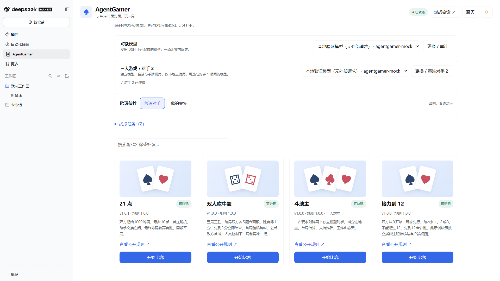
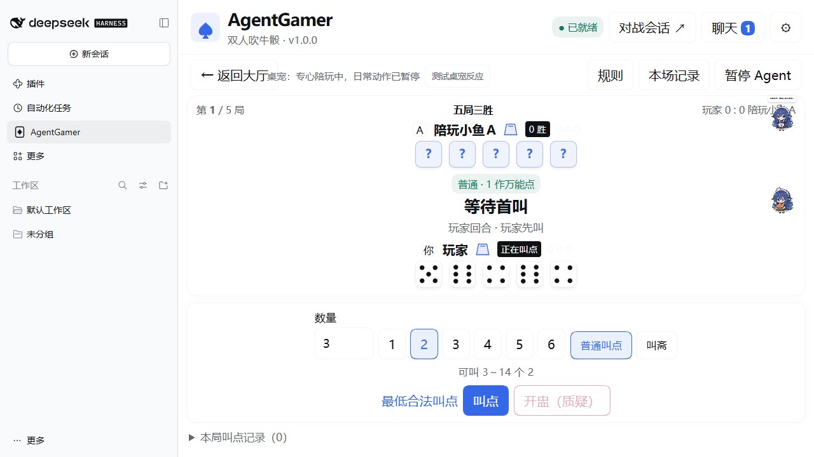

# AgentGamer

**简体中文** | [English](https://github.com/AnonNetizen/AgentGamer/blob/main/README.en.md)

在 **DeepSeek Harness（DSH）** 里，和 AI 或自己的桌宠伙伴面对面玩游戏。

内置 **21 点**、**双人吹牛骰**和**斗地主**，提供大厅、公开记录、文字／Emoji 聊天和 Web 游戏扩展接口。直接使用 DSH 已配置的模型与思考设置，无须另填 API Key。

[npm 安装](https://www.npmjs.com/package/dsh-agentgamer) · [离线发行包](https://github.com/AnonNetizen/AgentGamer/releases/latest) · [升级与迁移](https://github.com/AnonNetizen/AgentGamer/blob/main/docs/migration.md) · [桌宠陪玩](https://github.com/AnonNetizen/AgentGamer/blob/main/docs/companion.md) · [开发接入](https://github.com/AnonNetizen/AgentGamer/blob/main/docs/development.md)



大厅示例包含三款内置游戏及可选counting扩展；画面使用隔离配置与本地模拟模型。

## 安装

当前验证组合：**DSH 0.2.2-rc.1、Windows x64、Node ≥24.9**。插件精确声明此 DSH 版本；其他 DSH 版本需要重新验证接口兼容性。

已安装旧包 `dsh-plugin-agentgamer` 时，先按 [迁移说明](https://github.com/AnonNetizen/AgentGamer/blob/main/docs/migration.md) 移除旧包及对应旧扩展，再安装新包；同一Host只启用一个主插件。

1. 打开 DSH 侧栏 **插件 → 添加插件**，输入完整包名 `dsh-agentgamer` 并安装。
2. 按 DSH 提示重启，进入侧栏 **AgentGamer**，选择模型并连接，然后开始比赛。

也可以使用 CLI 按包名安装。**桌面版**先完全退出 DSH（包括托盘），使用该桌面版附带的 `dsh` 命令：

```powershell
dsh plugin --profile desktop add dsh-agentgamer
```

如果平时通过 `dsh web` 启动**浏览器版**，使用：

```powershell
dsh plugin --profile web add dsh-agentgamer
```

`desktop`／`web` 是运行配置名称，插件应安装到实际使用的同一 profile。自定义配置则填写启动时的名称。安装后重新打开对应 DSH；桌宠联动也要求两个插件启用在同一 Host。

**已有0.2.x升级到0.3.0**：完全退出DSH后，执行 `dsh plugin --profile desktop add dsh-agentgamer@latest`（浏览器版换为 `web`，自定义profile填实际名称）。若装有旧counting扩展，先移除，再升级主包，最后安装本次发行的新counting包；见[升级说明](https://github.com/AnonNetizen/AgentGamer/blob/main/docs/migration.md)。

需要离线包时，仍可从 [Releases](https://github.com/AnonNetizen/AgentGamer/releases) 下载 `dsh-agentgamer-0.3.0.tgz`，将上述命令中的包名换成 `./dsh-agentgamer-0.3.0.tgz`。如果侧栏没有入口，检查该 profile 的 `dsh.profile.bundles` 是否包含 `dsh-agentgamer`。

卸载示例（浏览器版将 `desktop` 换成 `web`）：

```powershell
dsh plugin --profile desktop remove dsh-agentgamer
```

从 `dsh-plugin-agentgamer` 或旧版 RushAgent 升级时，先按 [迁移说明](https://github.com/AnonNetizen/AgentGamer/blob/main/docs/migration.md) 移除旧插件及旧 counting 扩展，再安装新包。升级或关闭 Host 会结束内存中的比赛。

## 可以玩什么

| 游戏                              | 规则  | 玩法                                                 |
| --------------------------------- | ----- | ---------------------------------------------------- |
| [21 点](https://github.com/AnonNetizen/AgentGamer/blob/main/rules/blackjack.md)       | 1.0.0 | 起始各1000筹码，最多10手，轮流坐庄，Blackjack净赔3:2 |
| [双人吹牛骰](https://github.com/AnonNetizen/AgentGamer/blob/main/rules/liars-dice.md) | 1.0.0 | 每局各5骰，五局三胜，1作万能点，支持斋／飞与围骰     |
| [斗地主](https://github.com/AnonNetizen/AgentGamer/blob/main/rules/doudizhu.md) | 1.0.0 | 一名玩家＋两个独立模型席位，叫分选地主，单局结算，炸弹与春天计分 |

玩家控制下注、要牌／停牌、叫点／质疑、斗地主叫分与选牌，以及下一手／下一局。模型通过四个限定工具取得自身视角和执行行动；暗牌、对方未揭示骰面和随机状态保留在 Host。

斗地主先将对手1连接为普通模型，再单独选择并连接“对手2模型”；可以选相同或不同模型，两个会话始终分别持牌与行动。牌桌可分别查看会话、暂停或重试；农民共同胜负，但互不读取手牌。详见[斗地主与双模型](https://github.com/AnonNetizen/AgentGamer/blob/main/docs/doudizhu.md)。斗地主暂不接桌宠。

同一对手跨比赛、跨游戏复用专用会话。模型思考期间的聊天按顺序排队；模型错误时保留局面，可以暂停和重试。只有公开发言进入聊天栏，原始推理与工具轨迹可从“对战会话”查看。

## 我的桌宠

可选连接同一 Host 的 [dsh-pet 0.4.7](https://github.com/PC2005-cloud/dsh-pet)。大厅选择“我的桌宠”，预览人设与近期聊天，再连接具体实例。

- 游戏公开回复同步到桌宠气泡，连接与胜负有对应动作。
- 比赛期间专心陪玩，暂停日常随机动作和漫游；局间等待与模型暂停时继续保持，整场结束或返回大厅后恢复。
- 用户主动接管优先，需要时点“恢复专心陪玩”；减少动效时只显示静态状态与气泡。
- 结算后手动点“告诉桌宠”，才将公开战报交回桌宠记忆并额外调用它的聊天模型。普通气泡同步与占用续期不调用模型。

人设最多8 KiB，近期聊天最多10轮／4 KiB，与游戏近期聊天和公开结果共享12 KiB检查点。导入资料会进入 DSH 对战会话原始历史。详细预算、数据位置和故障处理见 [伙伴说明](https://github.com/AnonNetizen/AgentGamer/blob/main/docs/companion.md)。



## 操作与数据

支持100%／125%字号、减少动效、聊天抽屉及公开记录。21点可用 `H` 要牌、`S` 停牌，`Enter` 确认下注或下一手；聊天 `Enter` 发送，`Shift+Enter` 换行。输入框、菜单与弹窗隔离游戏快捷键。

牌局和平台聊天仅存 Host 内存，刷新页面保留，关闭 Host 后结束；显示偏好保存在浏览器。已点击发送的桌宠战报任务单独持久保存，未知发送结果只核对记录，不自动重发。DSH 原始会话和桌宠原生聊天遵循各自保存设置。插件不收集或单独存储模型 API Key。

## 开发

```powershell
pnpm install --frozen-lockfile --ignore-scripts
pnpm check
pnpm release:local
```

使用 **pnpm 11.28.5**、Node ≥24.9。常规检查包含TypeScript、规则／Host测试、80场历史C#规则黄金轨迹对照、构建及示例语法；只需要本仓库和Node工具链。发行包和校验值输出到 `release/`，不需要 Godot 或 .NET。

可选真实 DSH AgentLoop、性能和页面联调见 [开发说明](https://github.com/AnonNetizen/AgentGamer/blob/main/docs/development.md)，[架构](https://github.com/AnonNetizen/AgentGamer/blob/main/docs/architecture.md) 与 [验证记录](https://github.com/AnonNetizen/AgentGamer/blob/main/docs/verification.md)。CI在 Windows 和 Linux 上运行常规发行检查；真实宿主与窗口验证使用隔离的 Windows DSH 配置和模拟模型，不代表供应商策略或计费Token。

新增游戏可由另一个DSH插件注册，无须重编译主插件。SDK API保持1，最小示例在 [examples/counting](https://github.com/AnonNetizen/AgentGamer/blob/main/examples/counting/README.md)；对应独立包为 `dsh-agentgamer-counting-0.3.0.tgz`，不安装也能玩三款内置游戏。

## 许可证

[MIT](https://github.com/AnonNetizen/AgentGamer/blob/main/LICENSE)。随机流移植自 MaxGodotFrame，DSH Remote 描述符助手与 Zod 许可证见 [第三方来源](https://github.com/AnonNetizen/AgentGamer/blob/main/THIRD_PARTY_NOTICES.md)。
