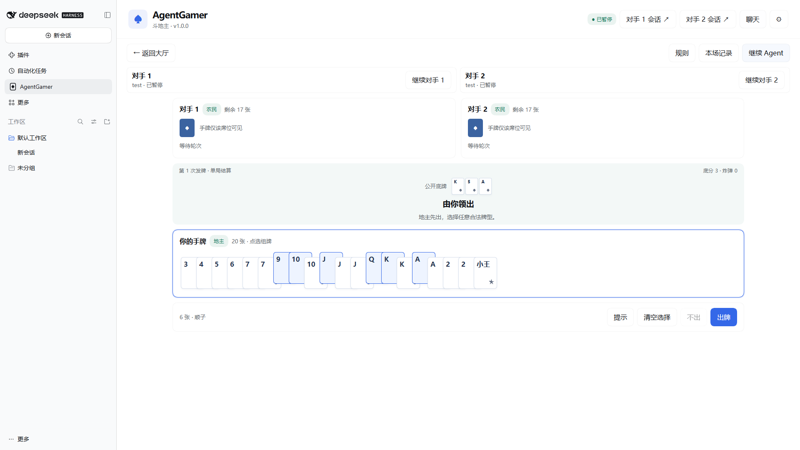

# 斗地主与两个模型对手

需要AgentGamer 0.3.0和DSH 0.2.2-rc.1，使用当前Host中已经配置的模型，不增加API Key配置。完整牌型细则见[规则1.0.0](../rules/doudizhu.md)。

## 开始

1. 大厅将“普通对手”作为对手1，选择“对战模型”并连接。
2. 在“三人游戏 · 对手2”选择模型并点“连接对手2”。两边可以选同一模型，也可以分别选不同供应商或模型；始终创建两个独立会话。
3. 点斗地主“开始比赛”。根据手牌叫0／1／2／3分；每人只叫一次，最高分当地主。全员不叫时点击“重新发牌”。
4. 点选自己的手牌组牌，点击“出牌”；“提示”轮换合法示例，“清空选择”保留手牌，“不出”仅在跟牌时可用。选好合法牌后可用Enter出牌；文本输入、聊天、按钮、弹窗和记录不会触发该快捷键。
5. 任一玩家出完即结算，显示地主／农民胜负和三方得分。分数仅代表这一局，不涉及金钱或持久余额。可再来一局或返回大厅。

## 两个会话怎样协作

- 轮到哪一位，就只唤醒该席位进行决策；两位农民共同胜负，依靠公开叫分和出牌配合，彼此看不到手牌。
- “对手1会话”和“对手2会话”分别打开对应DSH原始轨迹。原始轨迹中的自身手牌属于各自会话，不会自动交给另一个会话或人类牌桌。
- 全桌聊天中玩家消息向两个席位分别排队投递；公开回复标注发送方。Agent发言不会再自动唤醒另一Agent，避免无限对话。聊天与记录不推进规则修订。
- 模型失败保留局面，按对应席位“重试”。可以单独暂停某一席位，也可以使用上方“暂停Agent”暂停双方；没有代打、超时判负或自动换模型。
- 同一Host同时只有一场游戏。刷新或切换DSH页面保留牌局；离开、卸载游戏或关闭Host取消未完成任务。模型及对手选择在进行中的比赛锁定。
- 21点、双人吹牛骰和旧扩展只用对手1，对手2保留会话待下次斗地主复用。斗地主首版仅接普通模型，桌宠功能仍用于现有双人游戏。

## 消耗与数据

每位Agent独立使用已有的12 KiB公开记忆检查点，不共享原始模型历史或思考文本。斗地主给模型提供自己的手牌、公开出牌统计、最近出牌和最多24组合法出牌建议；完整公开记录仍可在界面查看。两位模型的费用各自计算，实际消耗取决于所选模型与思考设置。

牌局、平台聊天和计分不写入插件磁盘；DSH原始会话遵循DSH保存设置。不要将自己的私有手牌发进全桌聊天。当前没有双桌宠、联网真人对战、癞子、抢地主或跨局排行榜。

代表画面：[960×640／125%](images/doudizhu-small.png)、[单局结算](images/doudizhu-result.png)。截图使用隔离配置和本地模拟模型。
